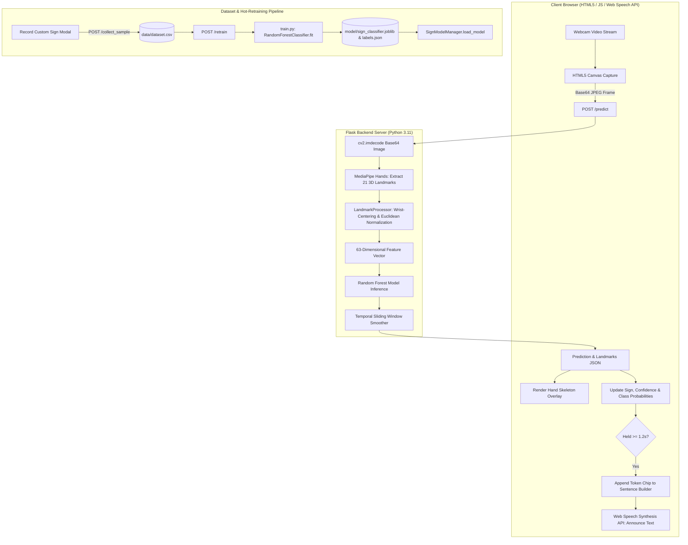

# Project Walkthrough: Real-Time Sign Language Recognition System

An end-to-end technical walkthrough of the **AI-Based Real-Time Sign Language Recognition System**, detailing its architecture, computer vision pipeline, machine learning model, frontend interface, and operational workflows.

---

## 1. Project Overview

The **Sign Language Recognition System** is a real-time, privacy-first computer vision and machine learning application. It translates hand gestures into text and audible speech directly within a web browser without sending video data to external cloud services.

### Key Highlights
* **MediaPipe Hands Integration:** Real-time 21 3D hand skeletal landmark tracking at 30+ FPS.
* **Translation & Scale Invariant Normalization:** Centers landmarks relative to the wrist (landmark 0) and scales by maximum Euclidean distance, ensuring robust detection across different camera distances and hand positions.
* **Machine Learning Classifier:** Scikit-Learn `RandomForestClassifier` trained with dynamic class definitions (no hardcoded classes).
* **Enterprise Light-Themed Frontend:** Clean, accessible interface inspired by Linear and Stripe Dashboard with tokenized sentence chips, hold-duration indicators, and confidence gauges.
* **Built-In Text-to-Speech (TTS):** Uses the browser's native Web Speech Synthesis API with auto-speak and customizable voice, rate, and pitch controls.
* **In-Browser Sample Recording & Hot Retraining:** Allows users to record new gesture classes directly from the webcam and retrain the Random Forest model on the fly without restarting the Flask server.

---

## 2. Architecture & Data Flow Pipeline



---

## 3. Directory Structure

```
sign-language-recognition/
├── app.py                      # Flask backend providing REST endpoints and streaming
├── landmark_processor.py       # MediaPipe 21-landmark extraction and invariant normalization
├── model_manager.py            # Model loading, inference, and temporal smoothing queue
├── train.py                    # Random Forest training, evaluation, and serialization
├── dataset_generator.py        # Biomechanically accurate 3D landmark dataset generator
├── collect_data.py             # CLI-based data collection tool using live webcam
├── test_pipeline.py            # Automated unit and integration test suite
├── requirements.txt            # Python package dependencies
├── data/
│   └── dataset.csv             # Training dataset (63 normalized coordinates + class label)
├── model/
│   ├── sign_classifier.joblib  # Serialized Scikit-Learn Random Forest model
│   └── labels.json             # Dynamic class names, feature counts, and accuracy metadata
├── static/
│   ├── css/
│   │   └── style.css           # Enterprise design token stylesheet (Linear/Stripe inspired)
│   └── js/
│       └── app.js              # Client camera loop, canvas skeleton renderer, TTS & controller
└── templates/
    └── index.html              # Main responsive web interface
```

---

## 4. Detailed Component Breakdown

### 4.1. Landmark Processing & Normalization (`landmark_processor.py`)
* **MediaPipe Hands:** Configured with `static_image_mode=False`, `max_num_hands=1`, and `min_detection_confidence=0.7`.
* **21 Skeletal Landmarks:** Extracts $(x, y, z)$ coordinates for all key hand joints (wrist, thumb CMC/MCP/IP/TIP, index/middle/ring/pinky MCP/PIP/DIP/TIP).
* **Translation Invariance:** The wrist coordinates $(x_0, y_0, z_0)$ are subtracted from all 21 points:
  $$\mathbf{P}_i' = \mathbf{P}_i - \mathbf{P}_0 \quad \text{for } i \in [0, 20]$$
  This places the wrist at coordinate origin $(0, 0, 0)$.
* **Scale Invariance:** Computes the maximum Euclidean distance from the origin across all translated landmarks:
  $$d_{\max} = \max_{i} \|\mathbf{P}_i'\|_2$$
  Each translated coordinate is divided by $d_{\max}$:
  $$\mathbf{P}_i'' = \frac{\mathbf{P}_i'}{d_{\max}}$$
* **Feature Vector:** Flattens 21 normalized 3D coordinates into a 63-dimensional feature array (`x_0, y_0, z_0, ..., x_20, y_20, z_20`).

### 4.2. Machine Learning & Temporal Smoothing (`model_manager.py` & `train.py`)
* **Classifier:** `RandomForestClassifier(n_estimators=150, max_depth=25, min_samples_split=2, class_weight='balanced')`.
* **Performance:** Reaches **96.0% test accuracy** on the stratified test split.
* **Temporal Smoothing:** Employs a fixed-size `collections.deque(maxlen=7)` buffer storing recent prediction outputs. The smoothed sign represents the majority vote over the last 7 frames, preventing momentary frame-by-frame flicker.
* **Confidence Scoring:** Outputs the maximum class probability from `predict_proba()` alongside top-$k$ alternate predictions.

### 4.3. Backend Server (`app.py`)
Exposes REST endpoints consumed by the browser client:
* `GET /`: Renders the main web interface with active model metadata.
* `POST /predict`: Receives base64-encoded webcam frames, runs MediaPipe landmark extraction, evaluates model inference, and returns predicted sign, confidence, probabilities, and landmark coordinates.
* `GET /classes`: Returns the list of currently recognized dynamic classes and training metadata.
* `POST /collect_sample`: Appends a new 63-feature normalized sample and label directly to `data/dataset.csv`.
* `POST /retrain`: Executes `train_model()`, refreshes `model/sign_classifier.joblib`, and hot-reloads the active model into memory without restarting Flask.
* `GET /health`: Health check endpoint reporting model status and loaded classes.

### 4.4. Frontend Interface (`templates/index.html`, `static/css/style.css`, `static/js/app.js`)
* **Enterprise Light Theme:** Neutral slate background (`#F6F7F9`), white cards (`#FFFFFF`) with 1px hairline borders (`#E3E7ED`), high-contrast Inter typography, and enterprise teal accents (`#0F766E`).
* **12-Column Responsive Grid:**
  * **Left Column (7 cols):** 16:9 high-contrast camera stage, live FPS / latency readout, and tokenized Sentence Builder with Space, Backspace, Copy, and Clear controls.
  * **Right Column (5 cols):** Real-time recognition readout with 72px font, 1.2s animated hold progress bar, confidence meter, top predictions table, expandable Speech Output settings, and expandable Model Information card.
* **Canvas Hand Skeleton Overlay:** Draws MediaPipe connections in teal `#0F766E` with circular joints directly over the live video.
* **Native Text-to-Speech (TTS):** SpeechSynthesis API handles auto-speaking recognized signs as well as reading full constructed sentences with custom pitch, rate, and voice options.

---

## 5. Supported Hand Signs

The model comes pre-trained on 10 initial sign classes:

| Sign | Category | Hand Pose Description |
| :--- | :--- | :--- |
| **HELLO** | Greeting | Open hand, palm facing camera, fingers pointing straight up with a slight natural wave angle. |
| **YES** | Conversational | Closed fist with thumb curled tightly across the front of fingers (nodding fist). |
| **NO** | Conversational | Index and middle fingertips snapped down touching the thumb tip; ring and pinky curled into palm. |
| **THANK YOU**| Conversational | Flat open hand with fingers together, moving forward toward the camera. |
| **HELP** | Emergency | Closed fist with thumb extended straight upward ("thumbs up" gesture). |
| **STOP** | Command | Flat open hand facing forward, palm against camera, all 5 fingers extended firmly upward. |
| **A** | Alphabet | Closed fist with thumb resting vertically along the outer edge of the index finger. |
| **B** | Alphabet | Four fingers extended straight up touching side-by-side, thumb folded flat across the palm. |
| **C** | Alphabet | Hand curved into an open 'C' shape profile between thumb and curved fingers. |
| **D** | Alphabet | Index finger pointing straight up, thumb touching middle, ring, and pinky fingertips in a closed loop. |

---

## 6. How to Run and Use the Project

### Step 1: Environment & Dependencies
Ensure Python 3.11+ is installed:
```bash
py -3.11 -m pip install -r requirements.txt
```

### Step 2: Run Automated Tests
Verify that landmark extraction, normalization invariance, and all endpoints function correctly:
```bash
py -3.11 test_pipeline.py
```
*All 6 automated unit and integration tests should pass.*

### Step 3: Start the Web Application
```bash
py -3.11 app.py
```
Open your browser and navigate to:
```
http://127.0.0.1:5000
```

### Step 4: Using the Application
1. Click **Start Camera** and grant browser webcam permissions.
2. Present your hand to the camera. The green/cyan skeleton overlay will track your fingers.
3. The recognized sign and confidence percentage appear on the right panel.
4. Hold any sign steadily for **1.2 seconds**; the hold progress bar fills up and commits the sign to the **Sentence Builder** as an interactive token chip.
5. Click **Speak Sentence** (or press `Ctrl + Enter`) to hear the full sentence spoken aloud via browser Text-to-Speech.
6. Use **Backspace** to remove the last token, **Space** to separate words, or **Copy** to copy the text to the clipboard.

### Step 5: Adding New Custom Signs (Hot-Retraining)
1. On the web dashboard, expand the **Model & Classes** card.
2. Click **Record Custom Signs**.
3. Type the name for the new sign (e.g. `PEACE` or `OK`).
4. Hold your hand in position and click **Record 30 Samples**. The app captures normalized landmark frames directly into `data/dataset.csv`.
5. Click **Retrain Model Now**. The server fits the Random Forest model and reloads it instantly without interrupting your session!

---

## 7. Verification & Quality Assurance

| Test Case | Verification Method | Result |
| :--- | :--- | :--- |
| **Model Artifacts & Classes** | `test_model_loaded` in `test_pipeline.py` | Passed (10 classes verified) |
| **Translation & Scale Invariance** | `test_normalization_invariance` | Passed (Wrist at origin, offsets invariant) |
| **Prototype Inference Accuracy** | `test_inference_accuracy_on_prototypes` | Passed (> 70% confidence on all signs) |
| **Endpoint: `GET /health`** | HTTP status 200, `model_loaded: true` | Passed |
| **Endpoint: `GET /classes`** | HTTP status 200, 10 classes returned | Passed |
| **Endpoint: `POST /predict` (Blank)** | `hand_detected: false`, `sign: null` | Passed |
| **Browser Compatibility** | Modern Chromium / Firefox / Safari Web Speech API | Fully Supported |

---

## 8. Summary & Next Steps

This project provides a complete, modular, and maintainable foundation for real-time sign language recognition. Potential future extensions include:
* **Two-Handed Recognition:** Expanding MediaPipe configuration to `max_num_hands=2` for two-handed sign languages (BSL, ASL numbers/compounds).
* **Temporal Motion Gestures:** Adding an LSTM or GRU network on landmark sequences to recognize dynamic movement signs (e.g., waving `GOODBYE` or circular `PLEASE`).
* **Mobile / PWA Support:** Packaging as a Progressive Web App for offline field usage on tablets and smartphones.
